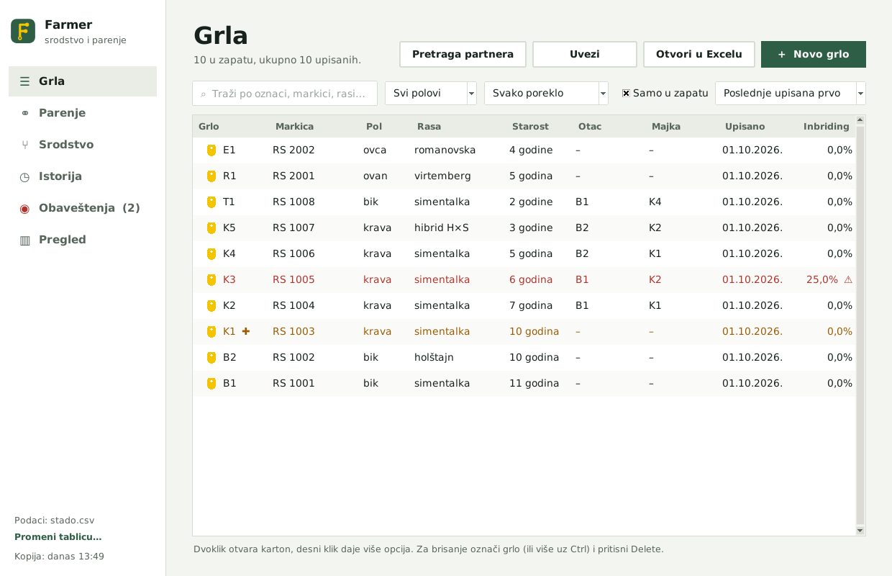
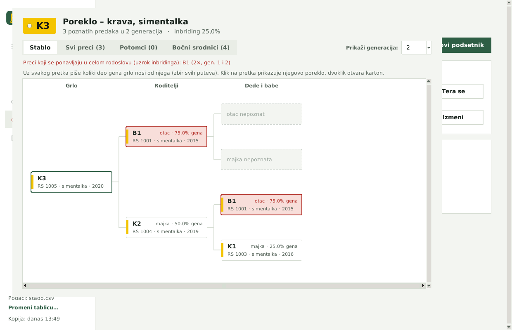
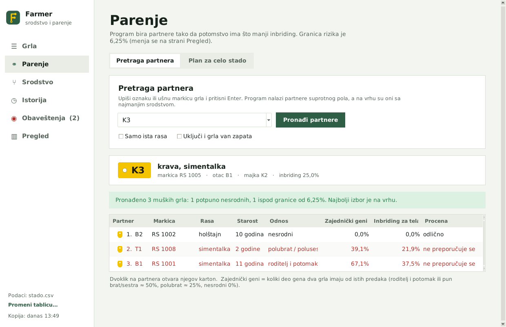
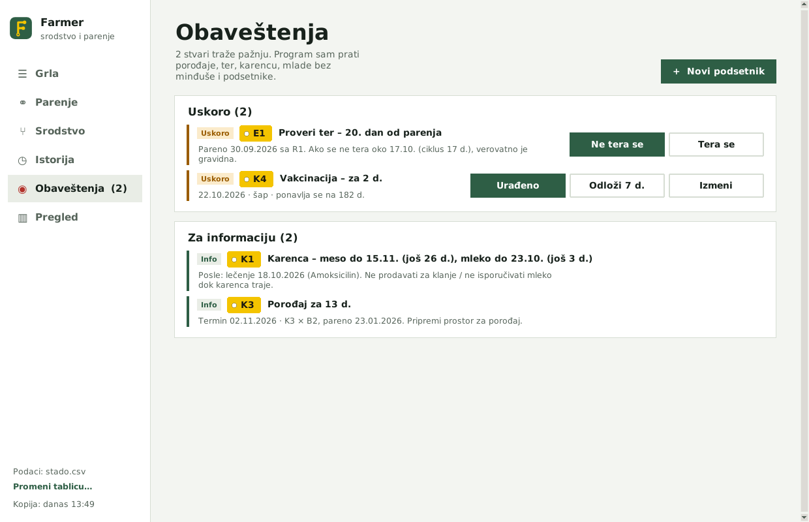
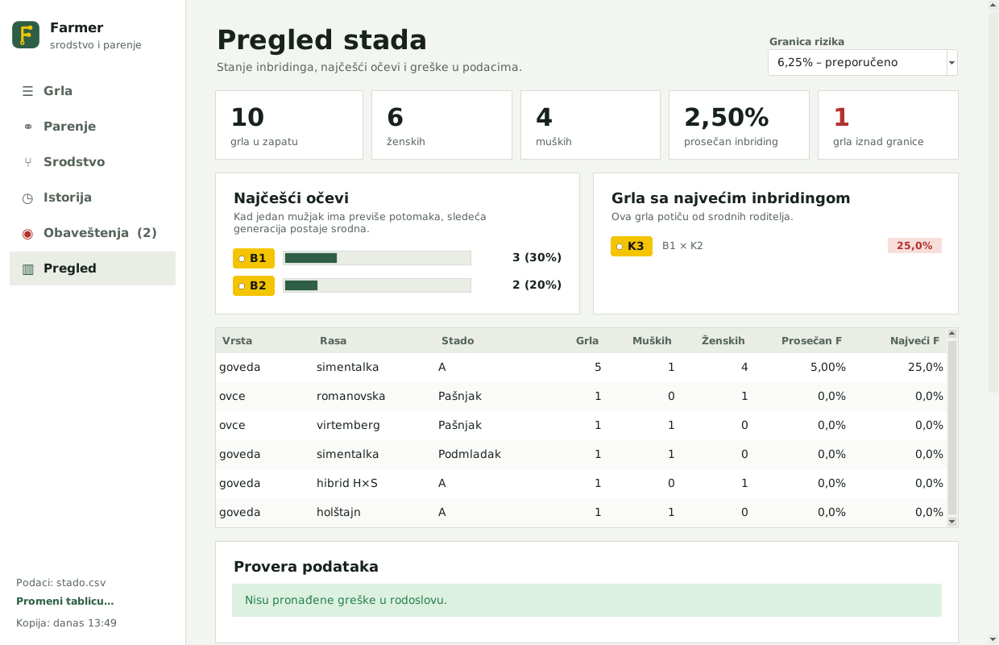

<p align="center">
  
</p>

<h1 align="center">Farmer</h1>

<p align="center">
  <b>Rodoslov stada · srodstvo · inbriding · plan parenja</b><br>
  Program za evidenciju grla, praćenje srodstva i biranje partnera za parenje.
</p>

---



## Šta program radi

- **Registar grla**: oznaka, ušna markica, vrsta, rasa, pol, datum rođenja, otac, majka, stado i poreklo.
- **Srodstvo i inbriding**: koeficijent inbridinga (F), zajednički geni dva grla i udeo gena od svakog pretka.
- **Pretraga partnera**: za izabrano grlo prikazuje partnere suprotnog pola. Najmanje srodni su na vrhu.
- **Plan parenja za celo stado**, uz granicu rizika koju sami podešavate (podrazumevano 6,25 %).
- **Rodoslovno stablo** sa karticama:
  - svi preci;
  - potomci;
  - bočni srodnici (braća, sestre, ujaci, tetke, rođaci).
- **Istorija grla**:
  - događaji: parenje, teranje, porođaj, vakcinacija, lečenje, merenje, premeštanje, prodaja;
  - otvara se desnim klikom na grlo.
- **Porođaji**:
  - posle parenja program računa očekivani datum porođaja, prema vrsti i rasi majke (npr. romanovska ovca 138–143 dana);
  - prvo se upisuje broj mladih, a mladi se kasnije prebacuju u spisak, kada dobiju markice.
- **Obaveštenja i podsetnici**: provera teranja, porođaji koji se bliže, karenca (meso / mleko) i vakcinacije koje se ponavljaju.
- **Plodnost ženki**: broj mladih po porođaju, međuporođajni interval i broj parenja po porođaju.
- **Mešanci**: rasa se automatski piše kao „hibrid O×M” (prvo slovo rase oca, pa majke).
- **Rezervne kopije**: svakog dana automatski, čuva se poslednjih 30.
- **Bezbedno brisanje**: obrisano grlo ostaje u rodoslovu. Brisanje svih grla ide u 5 koraka.

| Rodoslovno stablo | Pretraga partnera |
|---|---|
|  |  |
| **Obaveštenja** | **Pregled stada** |
|  |  |

## Pokretanje

Program je jedan Python fajl i ne traži dodatne biblioteke.

1. Instalirajte **Python 3.9 ili noviji** sa [python.org](https://www.python.org/downloads/). Na Windows-u pri instalaciji štiklirajte *Add Python to PATH*.
2. Preuzmite ovaj repozitorijum: **Code → Download ZIP**. Raspakujte ga u neku fasciklu.
3. Dvaput kliknite na **`Farmer.pyw`**.

Na Linuxu je potreban i Tkinter (`sudo apt install python3-tk`). Program se tada pokreće komandom `python3 Farmer.pyw`.

## Gde se čuvaju podaci

Svi podaci su u običnim CSV tabelama, u fascikli gde je i program. Mogu se otvoriti i u Excelu.

| Fajl | Sadržaj |
|---|---|
| `stado.csv` | grla |
| `stado_istorija.csv` | istorija (parenja, lečenja, porođaji…) |
| `stado_podsetnici.csv` | podsetnici |
| `rodoslov_podesavanja.json` | podešavanja |
| `rezervne_kopije/` | automatske i ručne kopije |

> Ovi fajlovi su navedeni u `.gitignore`, pa podaci o vašem stadu neće slučajno završiti na GitHub-u.

## Sadržaj repozitorijuma

```
Farmer.pyw            program
farmer.ico            ikonica (Windows)
assets/logo/          logo – SVG i PNG, svetla i tamna verzija
assets/ikone/         ikonica u veličinama 16–256 px
docs/slike/           slike ekrana
```
